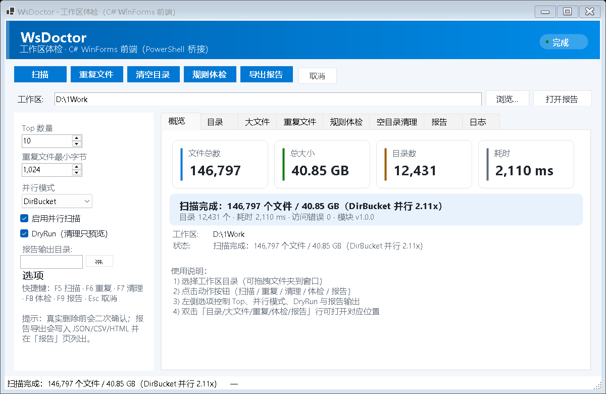

# WsDoctor GUI — C# WinForms 前端

用 **C# 写的前端 + PowerShell 桥接** 给 [WsDoctor](../docs/README.md) 做的桌面交互窗口。
本机没有 .NET SDK，但 PowerShell 7.6 是自包含版（`$PSHOME` 里带 Roslyn 编译器 + WinForms 程序集），
所以构建方式是用 **Microsoft.CodeAnalysis API 直接编译 C#**，编译产物由 `pwsh -STA` 宿主加载运行。



## 快速开始

```powershell
cd D:\1Work\项目\ws-doctor\gui

.\run.cmd                        # 双击也可以：自动编译并打开窗口
pwsh -STA -File .\run.ps1        # 等价的 PowerShell 方式
pwsh -STA -File .\run.ps1 -SelfTest       # C# 知识点自检（73 项断言）
pwsh -STA -File .\run.ps1 -Integration    # C#↔PowerShell 桥接集成测试
pwsh -STA -File .\run.ps1 -Screenshot out.png  # 离屏渲染截图\npwsh -STA -File .\run.ps1 -UiTest        # UI 回归：日志页重绘 3 轮\n.\dist-exe\WsDoctorGui.exe --uitest     # exe 版 UI 回归
pwsh -STA -File .\run.ps1 -Rebuild        # 强制重新编译
```

## 构建独立 exe（v1.2.0，使用 .NET SDK）

VS Code 的 C# 扩展已经在本机装好了 **.NET SDK 10.0.403 + WindowsDesktop 运行时 10.0.14**，所以除了上面的 Roslyn 动态编译，还可以直接产出标准 exe：

```powershell
cd D:\1Work\项目\ws-doctor\gui
.\build-exe.ps1          # 离线构建（不访问 NuGet）
.\dist-exe\WsDoctorGui.exe          # 打开窗口
.\dist-exe\WsDoctorGui.exe --selftest   # C# 自检（日志写到 %TEMP%\wsdoctor-gui\selftest.log）
```

产物 `dist-exe\`：`WsDoctorGui.exe`（apphost）+ `WsDoctorGui.dll` + `deps.json` + `runtimeconfig.json`，共约 **294 KB**，
框架依赖已安装的 .NET 10 Desktop Runtime（无需 self-contained 打包）。

工程文件：
- `WsDoctorGui.csproj`：`net10.0-windows` / `WinExe` / `UseWindowsForms` / `Nullable` / `Version 1.1.1`
- `app.manifest`：asInvoker + supportedOS（DPI 由 `Application.SetHighDpiMode` 处理）
- `NuGet.config`：`<clear/>` 清空源 → 零包依赖、可离线 restore
- `build-exe.ps1`：定位 dotnet → 设置 `DOTNET_CLI_HOME`（受限环境）→ `dotnet build -c Release` → 复制到 `dist-exe\`

> 为什么保留两套构建：`build.ps1`（Roslyn 动态编译，零 SDK 依赖）用于没有 .NET SDK 的机器/沙箱快速验证；
> `build-exe.ps1`（csproj + dotnet）用于分发独立 exe。
> 本机沙箱里 dotnet 需要 `DOTNET_CLI_HOME` 指向工作区（用户目录不可写）；脚本已自动处理，普通终端无需关心。

## self-contained 发布（v1.4，免安装 .NET）

```powershell
cd gui
.\publish-selfcontained.ps1              # 优先 dotnet publish（联网下载 runtime packs）
.\publish-selfcontained.ps1 -OfflineAssembly   # 离线：用本机 shared runtime 手工组装
.\publish-selfcontained.ps1 -Sign        # 组装后自动签名
```

产物 `dist-selfcontained\`（251 个文件 / 154.3 MB）：目标机器**无需安装 .NET**，但仍需要 PowerShell 7。

## 环境检查（v1.4）

```powershell
.\dist-exe\WsDoctorGui.exe --check-env
```

输出 OS / .NET / AppBase / ProjectRoot / 模块 / PowerShell 7 状态；日志写入 `%TEMP%\wsdoctor-gui\check-env.log`，退出码 0=正常 / 1=缺依赖。

## 扫描预计耗时（v1.3）

点「扫描」时会先调用 `bridge.ps1 -Action EstimateScan`（`Measure-WsScanWork`，只做剪枝枚举统计），
弹窗显示预计时间 / 文件数 / 目录数 / 串并行模式，用户可选择继续或取消。
实测 `D:\1Work`（11,766 文件）：串行估算 3s（实际 2.67s）、并行估算 2s（实际 1.78s）。

## 代码签名（正式发布：SignPath Foundation）

开源免费路线：由 SignPath Foundation 提供 OV 证书、在 HSM 中签名，工作流 `.github/workflows/release-signed.yml`。
申请步骤见 `docs/SIGNPATH-APPLICATION.md`。本地 `sign-exe.ps1` 只是开发用自签名。

## 代码签名（v1.3·自签名，开发用）

```powershell
.\build-exe.ps1
.\sign-exe.ps1          # 自签名 exe + dll，输出 signing\WsDoctorGui-CodeSigning.cer
```

发布包附带公钥证书与 SIGNING-README；验证 `Get-AuthenticodeSignature`。自签名在未信任的机器上显示「未知发布者」，
信任命令：`Import-Certificate -FilePath WsDoctorGui-CodeSigning.cer -CertStoreLocation Cert:\CurrentUser\TrustedPeople`。

## 重复检测的「预计加载时间」（v1.2）

点「重复文件」时 GUI 会先调用 `bridge.ps1 -Action Estimate`（`Measure-WsDuplicateWork`）做仅枚举+取样的工作量估算（约 2 秒），
然后弹窗显示：

- 预计耗时（两阶段哈希模型：取样 64 KB/文件 + 保守 3% 全量校验）
- 文件总量 / 同大小候选数量与体积 / 取样量
- 「是否继续？」——用户可当场取消，不会开始真正检测

实际耗时参考（`D:\1Work`）：v1.1 全量哈希 203.9s → v1.2 **5.6s（热缓存）/ 40s（冷缓存）**，
因为只会对"大小 + 前 64KB 都相同"的 897 个文件（442 MB）做全量 SHA256，而不是 17.59 GB。

## 架构

```
┌──────────────────────────────┐        ┌──────────────────────────────┐
│ WsDoctorGui.dll (C# WinForms) │        │  pwsh -File bridge.ps1        │
│  MainForm / Controls / Models │ ─────▶ │  Import-Module WsDoctor.psd1  │
│  BridgeService (Process)      │ 参数   │  Invoke-WsScan / Find-WsDuplicateFile │
│  PayloadMapperFactory (JSON)  │ ◀───── │  Remove-WsEmptyDirectory / Audit / Report │
└──────────────────────────────┘ 结果文件 └──────────────────────────────┘
         │ 读取 result-<action>-<guid>.json
         └─ 临时文件通信（不用 stdout 管道，规避受限环境的命名管道限制）
```

- **为什么用文件传结果**：受限沙箱里子进程的管道 stdio 可能不可用；桥接脚本把结果写成 JSON 文件，GUI 轮询读取，最稳。
- **取消**：`CancellationToken` → `Process.Kill(entireProcessTree: true)`，并清理临时文件。
- **DryRun**：清理/报告动作走 `-WhatIf` 预览；真实删除前 GUI 还会二次确认。

## C# 知识点地图（每个都对应到源码）

| 知识点 | 落点 |
|---|---|
| 命名空间 / 文件作用域 namespace / global using | 所有文件 + `GlobalUsings.cs` |
| `record`（位置参数、`with`、解构、值相等） | `Models.cs`（BridgeResult/ScanSummary/DirectoryRow…） |
| 模式匹配：`switch` 表达式、属性/关系/类型模式、`is` | `SelfTest.cs`、`Mappers.cs`、`MainForm.cs` |
| `enum` + `[Flags]` 风格 + 自定义特性 | `Models.cs`、`Attributes.cs` |
| 反射（读特性、构造对象、调方法、枚举字段） | `ActionCatalog`、`SelfTest.TestReflection` |
| 泛型（`Result<T>`、`Repository<T>`、约束 `where T : IComparable<T>`） | `Models.cs`、`SelfTest.cs` |
| 接口 + 继承 + 多态 + 工厂 | `IPayloadMapper` + `ScanMapper` 等 + `PayloadMapperFactory` |
| 可空引用类型 `#nullable enable` / `?` / `??` / `??=` | 全部源文件 |
| LINQ：查询表达式、GroupBy/Sum/Aggregate/Zip/Chunk、PLINQ | `Mappers.cs`、`SelfTest.cs` |
| `async/await`、`Task`、`CancellationToken`、`IProgress<T>`、退避重试 | `BridgeService.cs`、`MainForm.RunActionAsync` |
| `Process` / `ProcessStartInfo.ArgumentList` / `WaitForExitAsync` | `BridgeService.cs` |
| `System.Text.Json`：反序列化 record、`JsonElement`、自定义 Options | `Paths.cs`、`Mappers.cs` |
| 文件/目录 IO、临时文件、异常安全清理 | `BridgeService.cs`、`Paths.cs` |
| 自定义异常 + 异常过滤器 `catch when` | `BridgeException`、`SelfTest.cs` |
| 泛型集合 / 并发集合 / 环形缓冲 / 索引器 / 迭代器 `yield` | `LogBuffer.cs` |
| 事件 + 委托 + `INotifyPropertyChanged` / `PropertyChanged` | `Models.cs`、`MainForm.cs` |
| 扩展方法（JSON 读取、绘制、控件样式） | `JsonExtensions`、`DrawingExtensions`、`ControlStyling` |
| 自定义绘制：`OnPaint`/`GraphicsPath`/渐变/测量文本 | `Ui/Controls.cs`（HeaderPanel/StatCard/HeadlineBar） |
| WinForms：布局（TableLayoutPanel/SplitContainer/TabControl）、DataGridView、BindingList/BindingSource、DataBindings | `MainForm.Layout.cs` |
| Windows Forms 事件与交互：按钮、双击、拖拽、快捷键、OwnerDraw 日志、对话框 | `MainForm.cs` |
| `IDisposable` / `using` / 资源释放 | `BridgeService`、`LogBuffer`、`SelfTest` |
| 线程上下文：UI 线程 `InvokeRequired/BeginInvoke` | `MainForm.OnLogEntryAdded` |
| 字符串：插值、原始字符串 `"""`、格式化、范围索引 | `SelfTest.cs`、`Mappers.cs` |
| 元组/解构、`checked`、位运算、`Math.Clamp` | `SelfTest.cs` |
| 集合表达式 `[...]`、目标类型推断等新语法 | `Models.cs`、`MainForm.cs` |

## 验证

```text
- C# 自检：73 项断言全部通过（pwsh -STA -File run.ps1 -SelfTest）
- 集成测试：bridge 调用 / JSON 映射 / 进度回调 / 取消，6 项全通过（-Integration）
- 离屏截图：程序化渲染主窗口并保存 PNG（-Screenshot），无需人工点击即可回归 UI
- 真实窗口：启动后可在桌面看到并操作（后台 job / run.cmd 均可）
```

## 已知限制

- 需要 PowerShell 7（自包含版才带 WinForms/Roslyn）；Windows-only。
- 首次运行需 1–2 秒编译 C#（之后增量跳过）。
- 桥接以临时 JSON 文件传递结果，极端情况下需要清理 `%TEMP%\wsdoctor-gui\`。
- 依赖 `ws-doctor` 项目根目录（可通过环境变量 `WSDOC_GUI_ROOT` 覆盖）。
